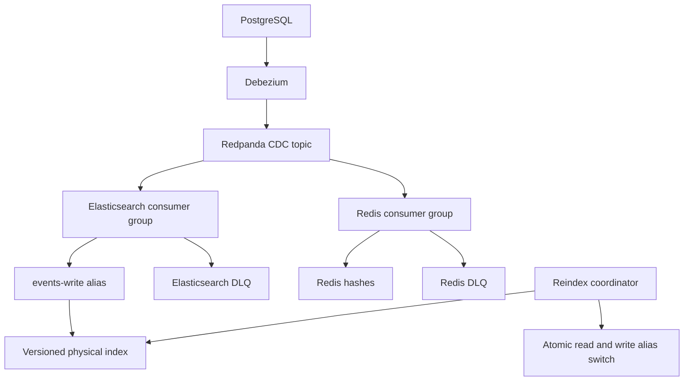

# Distributed CDC System

A Go change-data-capture pipeline that projects PostgreSQL rows into Elasticsearch
and Redis through Debezium and Redpanda. Each sink consumes independently, so a
search outage does not stop the cache. Includes replay-safe writes, poison-message
quarantine, and a fenced Elasticsearch reindex with an atomic alias switch.

**Status:** personal-project implementation, with unit tests and a Docker smoke
workflow. This is a local development topology, not a production deployment.
See [validation](docs/validation.md) for what was actually executed.

## Architecture



The worker uses an injected `Sink` interface. The two worker processes have
separate groups, offsets, retries and DLQs. Processing is sequential within each
process; there is no concurrent commit ordering hazard. Scale replicas within a
group only up to the number of partitions.

## Quick start

Requirements: Docker Engine with Compose v2, Bash, curl, Python 3, and enough
memory for the stack (allow about 4 GB). Native development uses Go 1.27.1.
On Linux, Elasticsearch may require `vm.max_map_count=262144` or higher.

```bash
bash scripts/bootstrap.sh
curl -fsS http://localhost:8083/connectors/postgres-cdc/status
bash scripts/smoke.sh
```

The bootstrap creates a demo `public.events` table, one-partition CDC and DLQ
topics, `events-v1`, the aliases, and the reindex lock index. It registers the
connector before starting the workers. Re-running it reuses existing resources;
it does not repair mismatched topic settings or migrate an old sink layout.
The smoke test performs insert, update, reindex and delete checks on a reserved
bigint ID. It creates a new physical index each time.

```bash
docker compose exec postgres psql -U app -d eventsdb -c \
  "INSERT INTO events(name,payload) VALUES ('hello','{\"source\":\"demo\"}');"
curl -fsS 'http://localhost:9200/events-read/_search?pretty'
docker compose exec redis redis-cli HGETALL event:1
docker compose logs -f worker-elasticsearch worker-redis
```

Search documents have `{ "deleted": false, "data": { ...row fields... } }`.
Query fields such as `data.name`. PostgreSQL JSONB is a JSON-encoded **string** in
Debezium's default output, so `data.payload` is mapped as text in the sample.
Redis uses one hash per ID: `version`, `deleted`, and `data` (JSON). Deleted hashes
retain version metadata but have no `data` field. No cache TTL or eviction is
allowed while relying on stale-write protection.

`events-read` excludes tombstones from searches. Elasticsearch alias filters do
**not** apply to GET-by-ID: clients using GET must check `deleted`, or use search.
Never write directly to a physical index; workers enforce `require_alias=true`.

## Delivery guarantees and boundaries

| Behavior | Guarantee / condition |
|---|---|
| Delivery | At least once. Commit follows a successful sink response or acknowledged poison-event DLQ publish. |
| Duplicate / older messages | ES strict external versions and an atomic Redis Lua script ignore equal or older versions. |
| Version token | Kafka offset + 1. This orders changes for a key, including multiple changes with equal PostgreSQL LSNs. |
| Stable partitioning | A primary key must stay in the **same topic and partition** for the lifetime of these sink namespaces. Never increase partition count or recreate the topic in place. |
| Deletes | Durable soft tombstones in ES and persistent Redis version hashes prevent late resurrection. |
| Sink outages | Five exponential-backoff attempts with jitter, then process exits nonzero without committing. Compose restarts it. An outage is never intentionally sent to DLQ. |
| Poison events | Invalid envelopes/keys/operations and ES document parsing/mapping errors go to the sink-specific DLQ. Operators must alert on and repair these omissions. |
| Shutdown / DLQ failure | No commit for the interrupted or unquarantined message. |
| Cross-sink consistency | Eventual and independent. No transaction spans Kafka, Redis and Elasticsearch. |
| Broker retention | Seven days in this demo. If lag exceeds retained history, recovery requires a fresh snapshot into new sink namespaces. |
| Infrastructure durability | Demo uses one broker and zero ES replicas; not resilient to disk/node loss. Redis uses AOF `appendfsync always`. |

Kafka commits and DLQ writes are not one transaction. A crash between them may
produce duplicate DLQ records; deduplicate on `(sink, topic, partition, offset)`.
Similarly, a sink write can succeed before a commit fails; version guards make
redelivery safe under the stable-partition contract.

The decoder supports **schema-enabled Debezium JSON envelopes** and signed bigint
`id` keys, including zero and negative IDs. It preserves JSON number precision.
It accepts snapshot/create/update/delete operations and Kafka null tombstones.
Other key types, schema-less messages, truncates and schema evolution need explicit
extensions. Primary-key changes must use Debezium's old-key delete/new-key create
behavior. The sample table uses `REPLICA IDENTITY FULL` for complete TOAST images.

## Reindex

```bash
# Edit elasticsearch/index-mapping.json for the next index, then:
docker compose --profile tools run --rm reindex -target events-v2
```

The coordinator locks migrations, creates a fresh index, fences writes to the
current physical index, refreshes it, and runs Elasticsearch `_reindex` with
external versions preserved. It copies **all documents including tombstones**,
checks task failures/conflicts and counts, then swaps `events-read` and
`events-write` in one aliases request. Kafka absorbs new changes during the pause;
the ES worker retries and catches up through the new write alias. Search and Redis
stay available. Elasticsearch freshness pauses for the duration of the copy.

This implementation uses a fenced **Elasticsearch snapshot copy**, rather than
the separate Kafka replay group sketched in the original diagram. That avoids
assuming the topic still contains every row's history. It rebuilds mappings for
existing indexed data; it cannot repair rows already missing from ES or apply
arbitrary application transformations. Full Kafka/DB resnapshot recovery is a
separate future feature. See [the reindex runbook](docs/reindex.md) for failure
recovery, operational constraints and why rollback is not automatic.

## Configuration

Set environment variables on the relevant Compose service or on a native worker.
The supplied stack intentionally uses fixed development defaults; it does not
load a custom `.env` application configuration.

| Variable | Default |
|---|---|
| `SINK` | `elasticsearch` (`redis` is the other supported value) |
| `REDPANDA_BROKERS` | `redpanda:9092` (comma-separated) |
| `CDC_TOPIC` | `app.public.events` |
| `CONSUMER_GROUP` | `cdc-<sink>` |
| `DLQ_TOPIC` | `<topic>.<sink>.dlq` |
| `ELASTICSEARCH_URL` | `http://elasticsearch:9200` |
| `ES_WRITE_ALIAS` | `events-write` |
| `REDIS_ADDR` | `redis:6379` |
| `REDIS_PREFIX` | `event:` |

The reindex CLI intentionally manages only `events-read` / `events-write` and
physical names matching `events-v[a-z0-9][a-z0-9_-]*`. Its flags are `-target`,
`-mapping`, `-url` and `-timeout` (30 minutes by default).
Do not give both sinks the same consumer group: that load-balances messages
between sinks instead of delivering every message to each sink.

## Fault tests

See [the testing guide](docs/testing.md) for the full test matrix and recovery instructions.
Chaos runs use a separate Compose project and separate data volumes, with no host ports.

```bash
bash scripts/test.sh unit
bash scripts/test.sh fuzz
python3 tests/chaos/run.py list
bash scripts/test.sh chaos --scenario redis-outage --scenario worker-crash
bash scripts/test.sh chaos --all --duration 10
python3 tests/chaos/run.py down --volumes  # Explicitly erase the disposable lab.
```

Fourteen selectable scenarios test outages, crashes, poison/DLQ barriers, replay,
persistence and reindex cutover/failure. Each checks the resulting state and writes
a JSON report. They are also available through a manual GitHub Actions workflow.

## Development and checks

```bash
cd worker
go mod verify
go vet ./...
go test -race -count=1 ./...
go build ./...
```

GitHub Actions runs these checks and a separate Docker integration job. Unit tests
cover decoding, integer precision, commit barriers, failure classification,
shutdown behavior, ES request semantics, and reindex failure/cutover paths.
Optional Redis integration tests run with `REDIS_TEST_ADDR=localhost:6379`.

```text
worker/
  main.go             process wiring, configuration and shutdown
  consumer/           sequential delivery, DLQ and commit barrier
  processing/         decoder and retry policy
  sinks/              sink interface, ES and Redis implementations
  elastic/            shared bounded HTTP client
  reindex/            lock, write fence, task validation and alias switch
  cmd/reindex/        migration CLI
scripts/              bootstrap and end-to-end smoke check
postgres/             demo source schema
elasticsearch/        target index definition
.github/workflows/    unit and Docker integration checks
```

## Operations

```bash
# Inspect lag and poison records
docker compose exec redpanda rpk group describe cdc-elasticsearch
docker compose exec redpanda rpk group describe cdc-redis
docker compose exec redpanda rpk topic consume app.public.events.elasticsearch.dlq -o start
# Inspect the lock/checkpoint after a failed reindex
curl -fsS http://localhost:9200/cdc-reindex-locks/_doc/events
# Stop while keeping data
docker compose down
```

DLQ payloads contain base64 original key/value bytes plus source position and error.
After fixing a sink mapping, stop that sink's group and reset it to the affected
**original** Kafka offsets using `rpk group seek`; restart to replay from source.
Check retention first. Do not blindly republish DLQ records to the source topic:
that assigns newer versions and can overwrite a newer correct row. There is no
automatic replay command in this release. Changes to malformed source records
should be corrected in PostgreSQL so Debezium emits a new valid event.

Watch connector status, consumer lag, worker restart counts, DLQ volume,
PostgreSQL replication slot WAL and disk usage. The 4 GB WAL cap can invalidate a
slot when Debezium falls too far behind; that requires planned snapshot recovery.
Structured worker logs record sink and source offsets. A metrics endpoint and
production alert rules remain future work.

## Publishing and deployment notes

The project is organized for a new GitHub repository; no repository has been
created or pushed. Extract it, run CI locally where possible, choose your license,
then commit the tree. A license has deliberately not been chosen on your behalf.

This release changes the original sink format and version scheme: use a fresh
stack or perform a planned full snapshot into new namespaces. Existing LSN-versioned
indices and Redis string keys are **not** compatible in place. PostgreSQL init SQL
only runs on a fresh data volume; apply the schema/replica-identity changes manually
when reusing an existing source database.

All passwords are local demo values, ES security is disabled, and exposed ports
bind to loopback. Production requires authentication/TLS, secret management,
replicated durable infrastructure, backups, retention sizing, access control for
aliases and the reindex lock, and a tested restore procedure. Never delete sink
version metadata, purge tombstones, reset the source topic, or bypass the migration
lock without rebuilding the associated namespaces.

## References

- [Kafka explicit commits](https://github.com/segmentio/kafka-go#explicit-commits)
- [Elasticsearch index blocks](https://www.elastic.co/docs/api/doc/elasticsearch/v8/operation/operation-indices-add-block)
- [Elasticsearch reindex](https://www.elastic.co/docs/api/doc/elasticsearch/v8/operation/operation-reindex)
- [Elasticsearch aliases](https://www.elastic.co/guide/en/elasticsearch/reference/8.19/aliases.html)
- [Debezium PostgreSQL connector](https://debezium.io/documentation/reference/3.1/connectors/postgresql.html)
